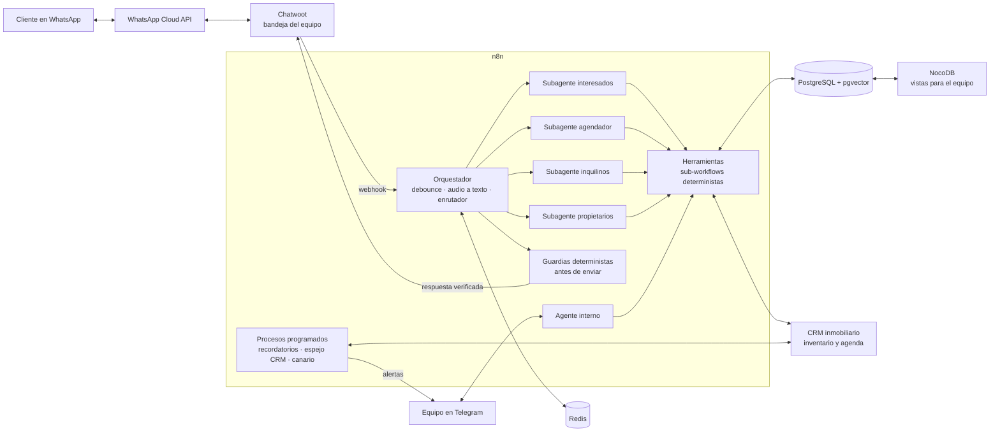

# Agente inmobiliario por WhatsApp

> **Nota de confidencialidad.** Proyecto desarrollado para un cliente bajo acuerdo comercial. El código completo y los datos pertenecen al cliente; aquí se muestra la arquitectura, las decisiones técnicas y fragmentos anonimizados.

## El problema

Una inmobiliaria atendía por **un solo número de WhatsApp** a tres públicos distintos: interesados en arrendar, inquilinos y propietarios. Dos personas se repartían los mensajes a ojo. Las respuestas dependían de quién estuviera libre, las visitas se agendaban a mano y nada escalaba.

## Qué construí

- **Un agente virtual de WhatsApp** que identifica quién escribe y lo deriva a un subagente especializado:
  - **Interesados:** busca inmuebles por lenguaje natural (búsqueda semántica), responde preguntas frecuentes, agenda, consulta y cancela visitas contra la agenda del CRM, y pasa la conversación a un asesor cuando hace falta.
  - **Inquilinos:** consulta pagos y registra reportes de daños con foto o video como evidencia.
  - **Propietarios:** consulta el estado de pagos de su inmueble.
- **Integración con el CRM inmobiliario del cliente:** espejo diario del inventario, sincronización horaria y envío de leads con deduplicación por teléfono.
- **Procesos programados:** recordatorios de visita con botones, cierre diario de agenda, seguimiento post-visita y aviso semanal de mora.
- **Un agente interno por Telegram para el equipo:** consulta la agenda del día, la ficha de un contacto y las conversaciones pausadas; cancela y reprograma visitas **con confirmación en dos pasos** y le avisa al cliente por WhatsApp.
- **Monitoreo:** un "canario" que avisa una sola vez cuando el CRM deja de responder o el espejo se atrasa.
- **Una batería de pruebas offline** que se corre antes de cada importación a n8n (ver abajo).

Detalle de cada workflow y sus nodos: [docs/workflows.md](docs/workflows.md).

## Arquitectura

El LLM decide **qué decir** y **qué herramienta llamar**. Todo lo que cambia el estado (agendar, cancelar, registrar) lo hacen sub-workflows deterministas, y todo lo que sale hacia el cliente pasa por guardias que lo contrastan con la base de datos.

## Stack

| Capa | Herramienta |
|---|---|
| Orquestación y agentes | n8n (AI Agent de LangChain, sub-workflows como herramientas) |
| LLM | OpenAI `gpt-5.6-luna` para los agentes, `text-embedding-3-small` para búsqueda semántica y Whisper para transcribir audios |
| Datos | PostgreSQL 16 + pgvector; Redis para agrupar mensajes |
| Canal | WhatsApp Cloud API + Chatwoot (bandeja del equipo) |
| Equipo | NocoDB (vistas tipo Kanban), Telegram (avisos y agente interno) |
| Infraestructura | VPS con Docker |
| Pruebas | Node.js y Python, offline sobre los JSON de los workflows |

## Decisiones técnicas clave

**1. El prompt no es un mecanismo de control.** El agente llegó a decir "quedaste agendado" sin haber llamado a la herramienta de agendar, aunque el prompt lo prohibía explícitamente, y el fallo se repitió al cambiar de modelo. Conclusión: antes de enviar cada respuesta, un nodo determinista compara lo que el agente **afirma** con lo que **existe** en la base (citas, horarios ofrecidos, inmuebles devueltos por la búsqueda). Si no coincide, bloquea el mensaje y escala a un asesor. → [ejemplos/04-guardia-afirmaciones.js](ejemplos/04-guardia-afirmaciones.js)

**2. Bloquear la mentira no alcanza.** Si el cliente eligió un horario válido y la cita no existe, el orquestador agenda por su cuenta. El disparo depende de hechos verificables (el número está en la lista de horarios ofrecidos, la lista es reciente y no hay cita activa), no del texto del modelo. La primera versión creó una cita fantasma cuando un cliente confirmó una cancelación: "sin cita activa" significaba dos cosas a la vez. Lo corregí con un discriminador explícito y la red se volvió a activar después de un guion de pruebas.

**3. El LLM no maneja identificadores.** La memoria de chat no guarda los resultados de las herramientas, así que el modelo no puede recordar un ID entre turnos. El agente elige **"A, B, C"** para inmuebles y **"1, 2, 3"** para horarios (dos alfabetos para que no choquen), y el servidor traduce a ID con un mapa guardado por contacto que vence si es viejo. Ante cualquier duda, falla cerrado. → [ejemplos/03-resolucion-por-numero.js](ejemplos/03-resolucion-por-numero.js)

**4. El tipo de cliente lo decide la base, no el modelo.** El enrutador mira el tipo registrado del contacto y el modo de la conversación. El modo "agendamiento" vence a los 30 minutos de inactividad: sin eso, un cliente quedaba atrapado en el subagente agendador, que no tiene búsqueda, y el modelo le inventaba inmuebles. → [ejemplos/02-enrutamiento.js](ejemplos/02-enrutamiento.js)

**5. Agenda curada, no disponibilidad abierta.** El bot solo ofrece horarios que el equipo publicó en el CRM. Así el CRM sigue siendo la fuente de verdad y la base local es un espejo.

**6. Con dos escrituras irreversibles, el orden lo decide el peor estado intermedio.** Para reprogramar, el agente interno primero agenda la nueva visita y solo después cancela la anterior. Si la segunda mitad falla, queda una visita duplicada, que se ve y se arregla. En el orden natural, el cliente se quedaría sin visita y nadie se enteraría.

**7. "No lo sé" es un tercer estado.** Si una consulta externa no responde, la herramienta lo dice. Nunca lo convierte en "no hay ninguna" o "no está pausada".

**8. Deduplicación local antes de crear en el CRM.** Antes de crear un lead, se busca el teléfono normalizado a 10 dígitos en un espejo local de clientes del CRM. Si existe, se enlaza; si no, se crea y se espeja. No se gasta ninguna llamada a la API para deduplicar. → [ejemplos/01-esquema-bd.sql](ejemplos/01-esquema-bd.sql)

**9. Primero observar, después bloquear.** Las guardias nuevas entran con un flag en "modo observación": detectan y registran, pero dejan pasar el mensaje. Solo bloquean después de revisar falsos positivos en tráfico real.

## Cómo valido que la IA no se equivoque

### Un proceso en tres etapas
1. **Mis pruebas.** Cada proceso se desarrolla y se prueba por separado. No avanzo hasta corregir todo lo que encuentro.
2. **Pruebas con el equipo del cliente, sin clientes reales.** El equipo recorre los flujos con sus propios casos. Todo lo que falla se corrige antes de salir.
3. **Salida gradual.** Empezó con un solo anuncio y se fue ampliando. Cada parte que se migra guarda su versión anterior para revertir en minutos. En producción aparecen errores que no se vieron antes; salir de a poco limita a cuántos clientes afecta cada uno.

### Qué corre antes de cada cambio
- **12 suites de pruebas offline.** Ejecutan el JavaScript real de cada nodo, extraído del JSON del workflow, con fechas congeladas para que el resultado no dependa del día.
- **Pruebas de cableado.** Recorren el grafo y verifican que ninguna acción irreversible (agendar, cancelar, escribirle al cliente) se pueda alcanzar sin pasar por su compuerta.
- **Sabotajes deliberados.** Cada defensa nueva se valida rompiéndola a propósito: si el test no falla, el test no sirve.
- **Modo observación.** Una guardia nueva primero solo registra. Bloquea recién después de revisar sus falsos positivos en tráfico real.

### Tres errores de la IA que parecían correctos
1. **Confirmó una visita que no existía.** El agente le dijo al cliente "quedaste agendado", y el mensaje se veía perfecto. La cita no estaba ni en el CRM ni en la base, y el registro de herramientas mostraba que nunca llamó a la de agendar. El prompt lo prohibía. Corrección: una guardia determinista que compara cada afirmación con la base antes de enviarla.
2. **La corrección creó otro error.** Agregué una red que agenda sola cuando el cliente eligió un horario y la cita no existe. Un cliente escribió "sí, cancela": la red leyó ese "sí" como "elijo el horario 1" y creó una cita fantasma. La causa: "no hay cita activa" significaba "el modelo no agendó" y también "se acaba de cancelar". Corrección: separar las dos condiciones, fijar el caso exacto como test y reactivar la red recién después de un guion de pruebas.
3. **Negó una visita que sí existía.** El agente contestó "no tienes visitas agendadas" desde la memoria del chat, sin consultar. La respuesta era coherente con el historial y falsa contra la base. Es el error más peligroso porque falla en silencio: el cliente no va y nadie se entera. Corrección: un segundo chequeo en la guardia.

### Programar con IA sin creerle a la IA
Escribo el código con Claude Code. La regla del proyecto es que ningún dato (nombre de columna, forma de un nodo, fecha) se usa sin verificarlo antes en la fuente. Dos casos que la regla atrapó:
- Un fixture de test asumía que el 6 de septiembre de 2026 era sábado. Era domingo, y el test validaba la suposición en vez del código.
- Varios tests pasaban porque encontraban el texto buscado en los **comentarios** del SQL, no en el código. Se corrigió quitando los comentarios antes de comparar.

## Resultados

**Operación**
- Atiende clientes reales desde septiembre de 2026, en una parte de los anuncios, y se va ampliando de forma gradual.
- **Tiempo de respuesta: de hasta un par de horas a segundos.** Antes dependía de la carga del equipo y de quién estuviera disponible. Es la experiencia del equipo, no una medición formal.
- **El bot responde todas las conversaciones que le llegan.** Un humano interviene solo cuando el bot pide ayuda: está instruido para escalar en lugar de responder lo que no sabe o no debe.
- **Agenda las visitas directamente en la agenda del CRM.** Cuando no puede (no hay horarios publicados o el CRM falla), avisa a un asesor en lugar de prometer.

**Técnicas (verificadas el 15-oct-2026)**
- 54 workflows de n8n versionados en git; los del núcleo están activos.
- 44 archivos SQL de esquema y migraciones.
- 12 suites de pruebas offline. Las 10 de Node.js corrieron en verde con **1.997 chequeos**.

## Próximos pasos

- **Difusiones** a interesados que no agendaron (envío masivo desde NocoDB con etiquetas por interés): escritas y con pruebas, pendientes de despliegue.
- **Centinela de errores** (aviso a Telegram ante cualquier fallo de workflow) y guardar la credencial del CRM en la base de datos: escritos, pendientes de despliegue.
- **Nota en Chatwoot** cuando el agente interno le avisa a un cliente: escrita, pendiente de despliegue.
- **Subagente dedicado a mantenimientos:** en desarrollo. Hoy los reportes de daño los atiende el subagente de inquilinos.
- **Rentas cortas** (segundo número y subagente de reservas): planeado, sin construir.
- Ampliar el bot a más anuncios del inventario.
