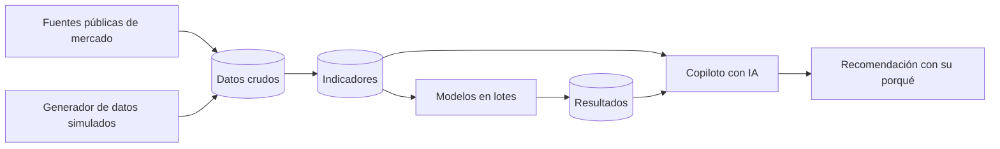

# Copiloto de decisiones de precio con IA

> **Nota de confidencialidad.** Proyecto desarrollado en mi empleo actual. Por confidencialidad no se publica código ni datos; aquí describo el problema, el enfoque y el resultado en términos generales. Es un prototipo personal, en fase de diseño, y todos los datos internos que usa son simulados.

## El problema

Las decisiones diarias de precio se toman con información dispersa: el margen está en un lado, el precio de la competencia en otro y el inventario por vencer en un tercero. Un tablero muestra lo que pasó, pero no dice qué precio poner hoy ni por qué. Hay dos factores que un motor de precios genérico no modela:

- **Coproducción.** De una misma materia prima salen varios productos a la vez, en proporciones fijas. Bajar el precio de uno para venderlo genera sobrante de los demás.
- **Vencimiento.** El producto es perecedero. Cada día pierde valor, y una recomendación que ignora la fecha de vencimiento no sirve.

## El enfoque

Un copiloto que responde en lenguaje natural con **una recomendación de precio y su razonamiento visible**. No toma decisiones automáticas ni entrega un número sin explicación.

- **Parte determinista:** una base de datos en capas (datos crudos → indicadores → resultados de modelos). Los modelos corren en lotes, nunca en vivo. Las restricciones de negocio (movimiento máximo de precio, distancia a la competencia, precio piso, balance de coproducción, urgencia por vencimiento) son parámetros, y el optimizador reporta **cuál restricción limitó** la recomendación.
- **Parte de IA (diseñada, todavía sin construir):** el modelo de lenguaje interpreta la pregunta, elige entre herramientas predefinidas y redacta la respuesta. Cita la fuente de cada número y responde "no tengo ese dato" antes que estimar. Para preguntas exploratorias tiene un canal de consulta de solo lectura, con límites, y siempre muestra la consulta que ejecutó.

**Herramientas:** Python, PostgreSQL y Docker, con pruebas automáticas. La capa conversacional está prevista con la API de Claude (tool use) y la interfaz con Streamlit. Desarrollo con Claude Code.

## Decisiones con criterio propio

1. **La IA no hace aritmética.** La base de datos calcula y el modelo de lenguaje solo redacta. *Por qué:* un número inventado que suena bien es el peor error posible en una decisión de precio.
2. **El cálculo está separado de la consulta, y la lógica separada de la herramienta.** Cada regla de negocio está documentada como fórmula, sin depender del lenguaje ni del motor. *Por qué:* así el diseño se puede trasladar al stack corporativo sin leer el código.
3. **Probar el método contra una verdad conocida.** Los datos simulados llevan una sensibilidad al precio inyectada a propósito. *Por qué:* estimarla con el histórico de ventas da resultados falsos, porque el precio sube justo cuando la demanda está fuerte. La meta es mostrar que el método ingenuo falla y que el corregido recupera el valor real. Esta parte está planeada.

## Cómo validé que los datos fueran correctos

Errores que parecían correctos y cómo se detectaron:

- **Un residuo de producto que no existía.** Al combinar dos fuentes de referencia medidas sobre bases distintas, apareció una fracción "por colocar" que parecía razonable. Se detectó al comprobar que en la fuente primaria las proporciones sumaban el total de otra base. Se corrigió la estructura en vez de forzar los números.
- **Sumar kilos no cuadra la coproducción.** Distintas presentaciones de un mismo producto consumen distinta cantidad de materia prima. El balance se lleva en unidades equivalentes de materia prima, no en kilos.
- **Cruces que duplican en silencio.** Un cruce por rango de fechas puede duplicar ventas e inflar el margen sin dar error. La regla se hace cumplir con una restricción en la base y un chequeo fijo: los totales después del cruce deben ser idénticos a los de antes.
- **Semanas que no cuadran.** La semana fiscal no coincide con la semana ISO. Confundirlas daría agregados que no cuadran con los reportes internos, sin ningún aviso. Por eso hay un calendario propio.
- **Supuestos de la IA que contradecían el negocio.** El asistente documentó una causa equivocada para los descuentos, y un documento de reglas traía una vida útil del producto incorrecta. Los dos casos se detectaron al contrastarlos con la operación real.

**Controles que quedaron fijos:** pruebas automáticas que fallan si a una tabla o columna le falta su descripción, si el diccionario de datos (generado desde la base) está desactualizado o si la documentación tiene enlaces rotos. La primera corrida de esta última encontró varios. Está diseñado un set de evaluación del agente con respuestas calculadas por una vía independiente, que incluye preguntas trampa donde lo correcto es "no tengo ese dato".

## Resultado

Todavía no reemplaza ningún proceso, así que no hay una medición de tiempo ni de impacto. Hoy existen un entorno reproducible, el modelo de datos diseñado sobre la estructura real con datos simulados, y cada decisión registrada con su porqué y su impacto en una migración.

**Próximos pasos:** crear las tablas, cargar las fuentes públicas, generar el histórico simulado, construir los modelos y el agente, y medir su confiabilidad con el set de evaluación.
