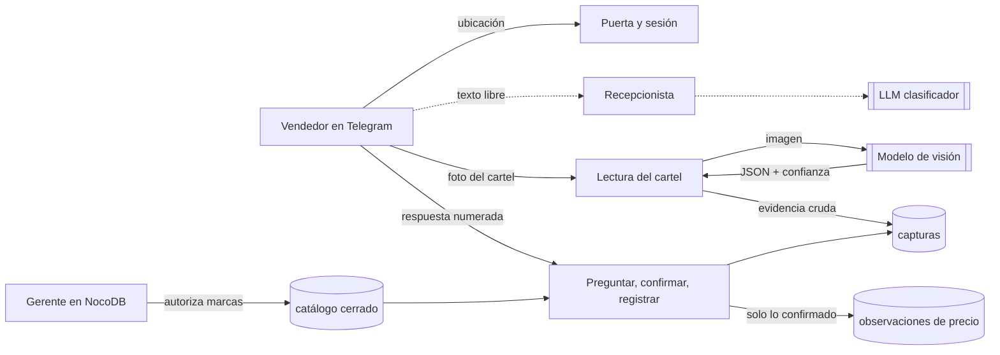

# Relevamiento de precios en góndola con IA

> Prototipo de mejora de procesos desarrollado para una empresa del sector avícola en
> Colombia. El catálogo, las marcas y los datos reales pertenecen a la empresa; aquí se muestran la
> arquitectura, las decisiones técnicas y fragmentos anonimizados.

## El problema

Los vendedores relevaban los precios de góndola en los supermercados y los enviaban por correo: sin
validación, sin registro fotográfico y sin filtros sobre qué productos o marcas se podían reportar. No
había forma de auditar un dato ni de compararlo. Si se automatiza con IA sin controles, aparece un
riesgo peor: un modelo de visión que lee `$12.900` como `12.90` llena la base de errores de factor 1000
que no se ven a simple vista. Una base así es peor que no tener base.

## Qué construí

Un MVP que demuestra la idea de punta a punta, probado en vivo con dos operadores de prueba:

- **Un bot de Telegram** al que el vendedor le comparte su ubicación y elige la sucursal entre las más
  cercanas (tope de 1 km).
- **Lectura del cartel con un modelo de visión**, que devuelve JSON con el producto, el precio vigente y el
  anterior, la cantidad (500 g, libra, kilo), la promoción y un nivel de confianza por campo.
- **Confirmación bloqueante:** el bot muestra lo que leyó y nada se registra hasta que la persona confirma,
  corrige el producto, corrige el precio o descarta. Lo dudoso se pregunta; lo que no está en el catálogo
  no entra.
- **Una base PostgreSQL** (8 archivos de esquema y migraciones, 11 tablas) donde las garantías son
  restricciones de la base, no promesas del bot. Incluye un precio por kilo comparable, anulación sin
  borrado, corrección que conserva el valor original y un control de qué marcas puede registrar cada
  cadena.
- **Una vista tipo hoja de cálculo (NocoDB)** para que un gerente autorice marcas por cadena con un clic,
  sin SQL.

## Arquitectura

**El LLM solo lee el cartel y traduce su vocabulario a los ejes del catálogo** (corte, tipo, estado). Lo
determinista decide todo lo demás: filtra contra el catálogo cerrado, decide qué falta preguntar, calcula
el precio por kilo, valida con restricciones de la base y exige la confirmación de una persona. La línea
punteada (P04) está escrita y probada contra el archivo, pero no se desplegó. Detalle por nodo en
[docs/workflows.md](docs/workflows.md).

## Stack

- **n8n:** un workflow de 32 nodos que agrupa las cuatro etapas (P01 a P04).
- **PostgreSQL 16:** con `pgvector` instalado pero todavía sin usar. NocoDB va encima como vista.
- **Modelo:** `gpt-5.6-luna` vía la Responses API de OpenAI, en las dos llamadas al modelo: lectura del
  cartel y recepcionista.
- **Telegram:** el canal con el vendedor.
- **Pruebas:** Node.js y Python, con contenedores Docker desechables y sin red.
- **Desarrollo:** con Claude Code. Cada pieza generada se validó con las pruebas de abajo antes de
  desplegarla.

## Decisiones técnicas clave

1. **Dos tablas: evidencia y dato confirmado.** `capturas` guarda toda foto que llega, con la respuesta
   cruda del modelo. `observaciones` solo acepta lo confirmado por una persona, con producto y marca del
   catálogo y precio positivo. *Por qué:* un bug del bot no puede meter un producto inexistente, y
   cualquier precio raro se audita contra la foto y contra lo que dijo el modelo.
   → [ejemplos/01](ejemplos/01-evidencia-vs-dato-confirmado.sql)
2. **El LLM traduce y el SQL filtra.** El modelo traduce "ALITAS" al corte `ala` y deja en `null` lo que el
   cartel no dice; una consulta resuelve contra el catálogo. *El error que la motivó:* la búsqueda por
   texto devolvió, ante un cartel de alitas congeladas, 3 pollos enteros y ninguna opción correcta.
3. **El precio por kilo lo calcula la base.** Es una columna generada, así que corregir un precio no deja
   el kilo desactualizado. *Por qué:* las fotos reales mostraron precios por 500 g y por libra, no por kilo.
   → [ejemplos/02](ejemplos/02-precio-comparable.sql)
4. **Lo que no viene con confianza "alta" es dudoso.** El bot avisa y ofrece elegir otro corte. *El error
   que la motivó:* ver el error 1 más abajo.
5. **El recepcionista no ve datos ni ejecuta nada.** Clasifica el texto en 8 intenciones cerradas y
   escribe una frase. La frase se descarta entera si trae un número, un `$`, un nombre del catálogo o un
   verbo de acción. → [ejemplos/03](ejemplos/03-veto-de-la-respuesta-del-llm.js)
6. **Solo se aprenden alias con evidencia completa.** Un texto de cartel se guarda como sinónimo solo si
   el modelo leyó los tres ejes con confianza alta. *El error que la motivó:* se suponía que "los alias
   salen de las fotos", pero de 11 carteles reales, 9 no decían si el producto era refrigerado o
   congelado. Guardar esa elección humana como alias la habría vuelto global.
   → [ejemplos/04](ejemplos/04-aprender-alias-solo-con-evidencia.sql)
7. **Lista de marcas cerrada, sin "otra marca".** Es un control de autorización. Una marca nueva la da de
   alta el gerente, no el bot.

## Cómo valido que la IA no se equivoque

### Mi proceso

1. **Mis pruebas.** Cada etapa (puerta, lectura, registro, recepcionista) se desarrolló y se probó por
   separado: primero contra el archivo, después contra una réplica de la base y recién después en vivo.
   No avancé hasta corregir lo que encontraba.
2. **Pruebas con el equipo usuario, sin salir a producción.** Es la etapa en curso: el proyecto está en
   fase de pruebas y la empresa decidió usarlo. Con el área de TI estamos revisando cómo adaptarlo a las
   condiciones de la empresa.
3. **Salida gradual.** Todavía no llegó a producción. Dentro del servidor de prueba se siguió un orden
   fijo:
   - medir el estado de la base antes de tocarla;
   - correr la migración y su verificación en el servidor;
   - recién después importar el workflow que la usa;
   - hacer un commit antes de cada importación para poder volver atrás.

   No hay scripts de rollback: un dato de prueba se anula con una marca, sin borrar la fila.

### Qué corre antes de cada cambio

- **Un auditor de SQL** que valida cada migración antes de entregarla. Lo construí porque el servidor se
  comparte con otro sistema en producción, y para que nada pueda tocarlo:
  - revisa el texto contra una lista negra (`DROP` ajeno, `GRANT`, extensiones, otras bases);
  - corre el esquema en una réplica sin red, con un usuario sin privilegios y una base ajena al lado;
  - antes de todo eso, se prueba a sí mismo con trampas conocidas.
- **Tres suites de pruebas sobre el workflow y sus consultas:** enrutamiento, textos, cableado entre
  nodos, consultas contra la réplica (incluida una carrera entre dos mensajes simultáneos) y que el
  recepcionista no tenga ningún nodo de base de datos en su camino.
- **Sabotajes deliberados:** cada chequeo nuevo se rompe a propósito para ver que falle. Si no falla, no
  valida nada.
- **Pruebas negativas en la base real:** cada restricción tiene un intento de violarla que debe fallar,
  dentro de un `ROLLBACK`. La bitácora registra 65, sin dejar filas de basura.

### Errores reales de la IA que parecían correctos

1. **El modelo de visión leyó mal una palabra nítida y lo afirmó.** Leyó "ALTAS DE POLLO" en un cartel de
   alitas y anotó *"el cartel dice literalmente…"*. Una misma foto borrosa de pechuga se leyó mal dos
   veces, como pollo: una con confianza "baja" y otra con "media". La regla original solo miraba "baja" y
   dejó pasar la segunda; el bot ofreció pollos enteros y la opción correcta ni aparecía.
   *Evidencia:* ese día, las 4 lecturas malas vinieron sin "alta" y las 4 buenas con "alta". *Cambio:*
   todo lo que no es "alta" se trata como dudoso, y el bot ofrece elegir otro corte.
2. **El auditor (escrito con IA) estaba ciego con más de 64 KB.** Con `grep -q` y `pipefail`, el `SIGPIPE`
   hacía que una coincidencia contara como "no encontrado", y solo dentro del contenedor. *Evidencia:* un
   `DROP TABLE` delante de 70.881 bytes pasó 5 de 5 veces. *Cambio:* se corrigió y el auditor ahora se
   prueba a sí mismo con un `DROP` escondido detrás de ~260 KB.
3. **Pruebas negativas que pasaban por la razón equivocada.** De 18 verificaciones, 12 fallaban por la
   primera clave foránea y no por la regla que querían probar: se contaba un error y no se había probado
   nada. Lo mismo con una cantidad de 0 g, que fallaba por división por cero antes de llegar a su
   `CHECK`. *Cambio:* cada negativa tiene que nombrar su propia restricción, y la de 0 g pasó a −500 g.
   (El ejemplo 02 reproduce el caso.)
4. **Una validación que "verificó" el escenario prohibido.** La primera prueba del esquema usó un usuario
   creado por `initdb`, que es superusuario, justo lo que había que evitar. *Cambio:* una réplica con un
   usuario sin privilegios y una base ajena al lado; ahí la pared devolvió `permission denied`.

**Código generado con IA que rechacé:** el asistente propuso una opción "0. Otra marca" en la lista. Habría
anulado el control de autorización de marcas, que era justamente el objetivo de esa lista.

## Resultados

**Operación y negocio**
- El MVP registró precios reales de carteles en vivo, con dos operadores, contra sucursales de prueba
  (inventadas a propósito: el padrón real se carga en la adaptación con TI).
- Frente al proceso anterior (precios por correo, sin validación, sin foto y sin filtros), cada precio
  registrado queda con su foto, la lectura cruda del modelo, la confirmación de una persona, un producto
  del catálogo y una marca autorizada para esa cadena. Es una mejora de proceso; todavía no hay una
  medición formal de tiempo o de errores.
- La empresa decidió usarlo. Está en fase de pruebas, y con TI estamos revisando cómo adaptarlo a sus
  condiciones.

**Técnicas (verificadas el 15-10-2026)**
- Lectura a ciegas con el modelo de producción: 4 de 4 carteles sin un campo mal, sobre 11 carteles
  distintos disponibles. Las trampas incluían un precio con punto de miles impreso al lado de su precio
  por gramo con coma decimal (no se corrió el factor 1000), un "Ahorro $…" que no debía tomarse como
  precio, y el logo de una marca impreso fuera del cartel (devolvió marca vacía en vez de inventarla).
- Pruebas corridas para este README, todas con 0 fallas:
  - enrutamiento del workflow: 166 chequeos;
  - consultas de registro contra una réplica de PostgreSQL: 127;
  - mensajes del bot: 41;
  - auditor de aislamiento sobre los 8 archivos de esquema: 39 (9 autopruebas, 16 de revisión del texto
    y 14 en la réplica).
- 65 pruebas negativas corridas en la base real, según la bitácora del proyecto.

## Próximos pasos

- Importar el recepcionista (P04) y probarlo en vivo: la llamada, el veto con respuestas reales y el
  costo.
- Terminar con TI la adaptación a las condiciones de la empresa y cargar el padrón real de sucursales y
  marcas autorizadas.
- Ampliar la prueba a ciegas a los 11 carteles. Medir si la confianza "alta" sigue separando lecturas
  buenas de malas con más fotos.
- Probar la restauración del respaldo diario y sacarlo del servidor.
